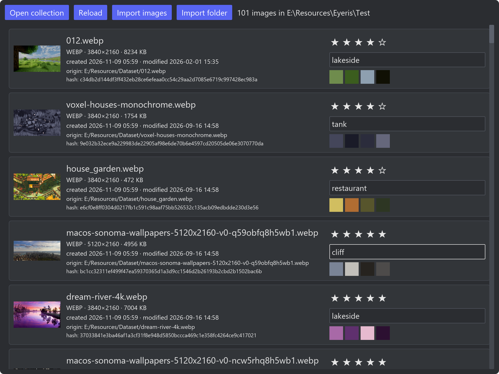

<h1 align="center"><strong>Eyeris</strong></h1>

<p align="center">A Digital Asset Management for the rest of us</p>

<p align="center"><i>*Something like <a src="https://www.digikam.org/"><strong>digiKam</strong></a> and <a src="https://eagle.cool/"><strong>Eagle</strong></a> but haven't been yet any stable.*</i></p>

&nbsp;

> [!NOTE]
> **Repository Archived**  
> This repository was publicly archived on November 11, 2026. Now read-only and no longer maintained.

&nbsp;

## 🖼️ **Screenshots**



&nbsp;

## 📐 Design

Borrow concept and design from _**digiKam**_ and _**Eagle**_.

Eyeris manage images in **Collection**, basically a normal folder managed by the app it self.

Structure of a **Collection** is somewhat similar to **Library** in _**Eagle**_:

```sh
<collection>/
├── embeddings/             # embeddings created by VLM, for semantic search
├── images/
│   ├── 1dn32hf...rbs/              # named by image hash, contain image and its thumbnail
│   │   ├── <image-name>.<image-ext>        # original image
│   │   └── thumbnail.png                   # thumbnail
│   ├── j5f49hf...asd/
│   │   └── ...
│   └── ...
└── index.db              # sqlite3 database store all images data
```

### Database

The only database file `index.db`, for now contain only table `images`.

`images` table schema:

| Column   | Type    | Description                             | Example                              |
| -------- | ------- | --------------------------------------- | ------------------------------------ |
| id       | INTEGER | Auto-incrementing                       | `42`                                 |
| origin   | TEXT    | Relative path to image                  | `"~/Pictures/Wallpapers/sunset.png"` |
| fullname | TEXT    | Image fullname                          | `"sunset.png"`                       |
| name     | TEXT    | Image name                              | `"sunset"`                           |
| format   | TEXT    | Image format                            | `"PNG"`                              |
| size     | INTEGER | File size in bytes                      | `2478406`                            |
| width    | INTEGER | Image width in pixels                   | `3840`                               |
| height   | INTEGER | Image height in pixels                  | `2160`                               |
| created  | INTEGER | Creation timestamp (ms)                 | `1792321201`                         |
| modified | INTEGER | Modification timestamp (ms)             | `1792321201`                         |
| rating   | INTEGER | User rating (0 to 5)                    | `3`                                  |
| tags     | TEXT    | Tags separate by pipe                   | `"girl\|beach\|sunset"`              |
| hash     | TEXT    | BLAKE3 hash of pixels (hex 64)          | `"35872f721...684"`                  |
| color_1  | INTEGER | Dominant color #1 in decimal            | `12431782`                           |
| color_2  | INTEGER | Dominant color #2 in decimal (may null) | `7630177`                            |
| color_3  | INTEGER | Dominant color #3 in decimal (may null) | `0`                                  |
| color_4  | INTEGER | Dominant color #4 in decimal (may null) | `NULL`                               |
