<p align="center"></p>
<h1 align="center"><strong>Eyeris</strong></h1>

<p align="center"><strong>A Digital Asset Management for the rest of us</strong></p>

&nbsp;

---

&nbsp;

**Authors:** [Nguyễn Thế Anh](https://github.com/ForeverWeLearn) & [Châm Duy Khoát](https://github.com/sainoman15)

**Course:** DAP391m

**Supervisor:** Nguyễn Thị Hoàng Yến

**Date:** November 2026

**Repository:** [FwLKhW/Eyeris](https://github.com/FwLKhW/Eyeris) · Archived on Nov 11, 2026

**Keywords:** digital asset management, image indexing, image tagging, semantic search, vision-language embeddings, Rust, Python

&nbsp;

## About

Personal image collections grow faster than the tools that organize them.

**Eyeris** is an experimental, local-first Digital Asset Management (DAM) system that aims to sit between open-source feature rich tools like [**digiKam**](https://digikam.org) and polished but closed ones like [**Eagle**](https://eagle.cool).

It's designed to stores images in a self-managed *Collection* (just a plain folder with databases), deduplicates by pixel hash, extracts dominant colors, auto tagging, and semantic search through vision-language embeddings. Reasonable for a 1 month project.

But the system ended up in a terrible hybrid prototype: a **Rust** core handles initial indexing and a desktop GUI, while **Python** handles embeddings, tagging, filtering, and exploratory analysis in notebooks. It works... fine, maybe.

The cost to work in both two languages is headache. Implicit schemas, subprocess calls, and duplicated logic made the design ugly, even XMP metadata write-back never became usable. So badly...

We decided to archive the repository to start a successor with a cleaner architecture.

This report documents what was built, what worked, and what we would do differently.

&nbsp;

## 1. Introduction

### 1.1 Motivation

Photographers, designers, and hobbyists have thousands of images. Organize them in folder hierarchy just get harder day by day, and finding "black hair cat girl sleeping chilly on sofa" means scrolling over 10 different folders.

We wanted something simple enough that a collection is just a folder, yet smart and versatile enough to search by meaning and by many image properties.

### 1.2 Goals and Scope

The project aim to archive:

- Self-contained collection without duplicates
- Manage useful metadata (size, dimensions, timestamps, rating, tags, dominant colors)
- Semantic text-to-image search and automatic tagging
- Explore collection easily in a polish UI (failed)

Out of scope: RAW formats, video, editing.

&nbsp;

## 2. Related Work

Eyeris borrows concepts from **digiKam** and **Eagle**, and its implementation are somewhat inspired by them.

| App     | Strengths                                  | Weaknesses                            | Inspired                                             |
| ------- | ------------------------------------------ | ------------------------------------- | ---------------------------------------------------- |
| digiKam | Open source, rich metadata and XMP support | Dense interface, heavy for casual use | XMP, tagging model                                   |
| Eagle   | Pleasant UX, library-as-folder model       | Proprietary                           | The *Library* concept, which became our *Collection* |

Further, Eyeris applies SigLIP 2 and Perception Encoder for text-to-image retrieval and auto tagging. Embeddings are stored in ChromaDB.

&nbsp;

## 3. System Design and Architecture

### 3.1 Design Principles

- **A collection is a folder.**
- **Content-based identity.** Images live in folders named by the hash of their pixels.
- **Local-first.** All models and data are offline, though require download.
- **Metadata portability.** Ratings and tags should live in the image itself via XMP, and both in the database. (failed)

### 3.2 Collection Layout

```
<collection>/
├── embeddings/             # ChromaDB store for semantic search
├── images/
│   └── <hash>/
│       ├── <name>.<ext>    # copied original
│       └── thumbnail.png   # 512 px thumbnail
└── index.db                # SQLite, table `images`
```

<p align="center">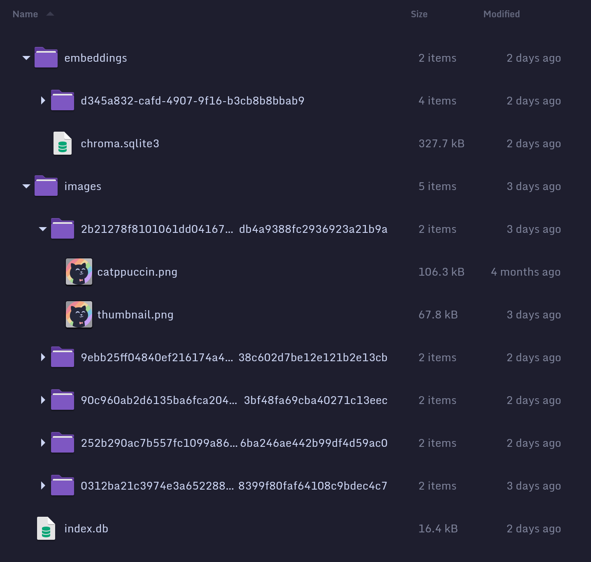</p>
<p align="center"><i>Collection layout on disk</i></p>

### 3.3 Hybrid Architecture: Rust and Python ⊙▃⊙?!

The codebase is roughly 40% Rust and 60% Python.

```
───────────────────────────────────────────────────────────────────────────────
Language            Files       Lines    Blanks  Comments       Code Complexity
───────────────────────────────────────────────────────────────────────────────
Rust                   17       1,162       165       105        892        145
Python                  9         822       178        56        588         77
Jupyter                 7       1,606         0         0      1,606          0
```

<p align="center"><i>Lines of code count, generated using <strong>scc</strong></i></p>

The intent was to use each language where it is strongest: Rust for CPU-bound, parallel, I/O-heavy work; Python for the machine-learning ecosystem and fast notebook-driven experimentation.

| Layer         | Language | Responsibility                                   | Main components                                                         |
| ------------- | -------- | ------------------------------------------------ | ----------------------------------------------------------------------- |
| Core          | Rust     | Hashing, color extraction, thumbnails, DB writes | `index`, `hash`, `color`, `thumbnail`, `db`, `collection`, `cli`, `efs` |
| GUI           | Rust     | Browse, import, rate, tag                        | `gui` (`iced`)                                                          |
| ML & analysis | Python   | Embeddings, tagging, filtering, EDA              | `embed`, `ss`, `tag/*`, `filter`, `eda`, notebooks                      |

*We won't say that we must do this just because we have no choice. (more in Devlogs #1)*

### 3.4 Languages Interaction

Python and Rust share no types or process. They communicate in two ways:

1. **Python → Rust via subprocess.** Python call to the compiled `cli` binary to add folder or add images to collection.
2. **Both read and write `index.db` directly.** Rust creates the table; Python queries it with `pandas` and updates with raw SQL.

This was quick to build, but it means the schema exists implicitly, in two languages, with no authority (see Section 6).

&nbsp;

## 4. Implementation

### 4.1 Indexing

For each image:

- Collects filesystem metadata
- Reads XMP properties
- Computes pixel hash
- Extracts dominant colors

Images are processed in parallel with `rayon`.

Successfully indexed images are inserted in a single transaction, then copied into `images/<hash>/` and given a thumbnail (also in parallel).

### 4.2 Database Schema

A single `images` table holds all metadata. 

| Column                   | Type    | Description                                     |
| ------------------------ | ------- | ----------------------------------------------- |
| id                       | INTEGER | Primary key                                     |
| origin                   | TEXT    | Original path (slash-normalized)                |
| fullname / name / format | TEXT    | File name, stem, uppercase extension            |
| size                     | INTEGER | Bytes                                           |
| width / height           | INTEGER | Pixels                                          |
| created / modified       | INTEGER | Unix timestamps (ms)                            |
| rating                   | INTEGER | 0–5                                             |
| tags                     | TEXT    | Pipe-separated                                  |
| hash                     | TEXT    | BLAKE3 of pixels, unique                        |
| color_1 … color_4        | INTEGER | Dominant colors as packed `0xRRGGBB` (nullable) |

Simplify queries at the cost of normalization:

- **Tags** are stored as one pipe-separated string (e.g. `"girl|beach|sunset"`)
- **Dominant colors** are packed into up to four integer columns (`0xRRGGBB` as decimal)

### 4.3 Deduplication by Pixel Hash

The `hash` column is the BLAKE3 digest of the decoded RGBA16 pixel buffer, declared `UNIQUE ON CONFLICT IGNORE`. Two files with identical pixels collapse into one entry even if their format or compression differs.

This catches EXACT duplicates only.

### 4.4 Color Analysis

<p align="center">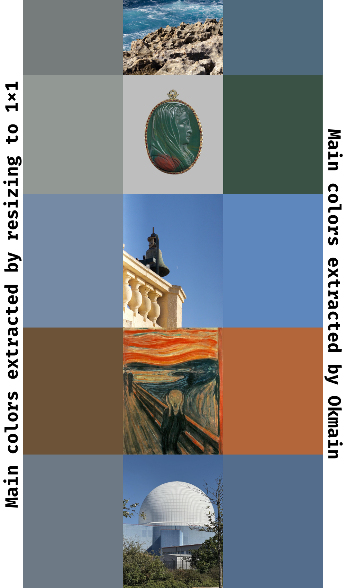</p>

Up to four dominant colors are extracted per image with the `okmain` crate. Which under the hood using K-Means on OKLAB color space.

<p align="center">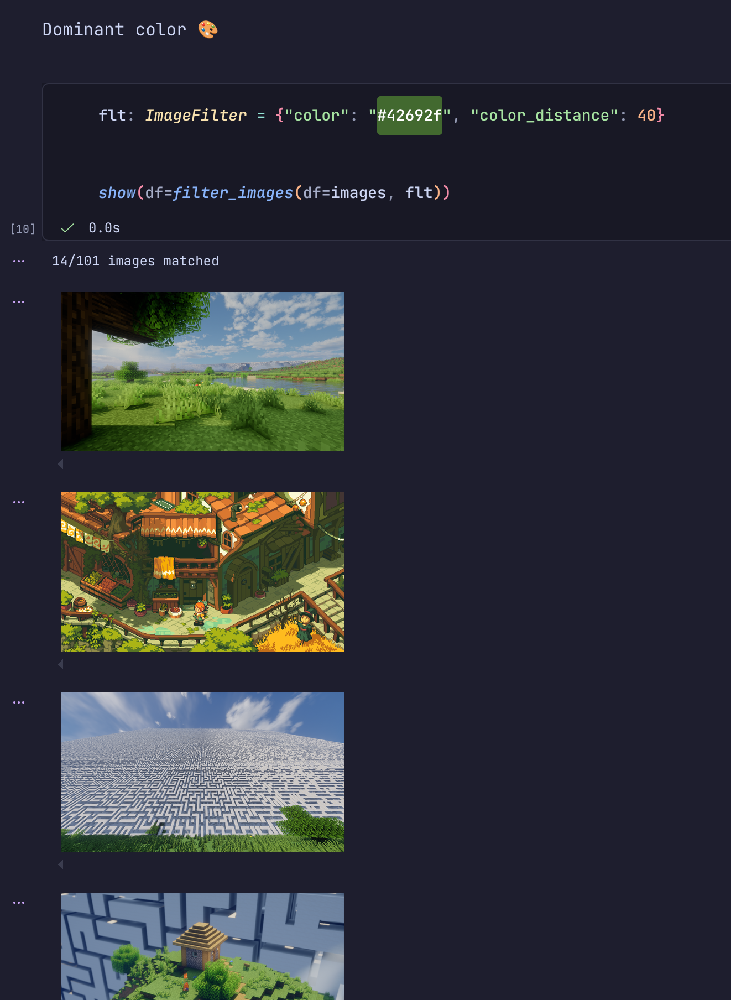</p>
<p align="center"><i>Filter by a green color</i></p>

On the Python side, colors are converted to the OKLCH color space, where hue is grouped into ten named bands (red … pink) and low-chroma colors are classified as black, gray, or white by lightness. This is used for color filtering, lightness buckets.

### 4.5 Semantic Search and Tagging

| 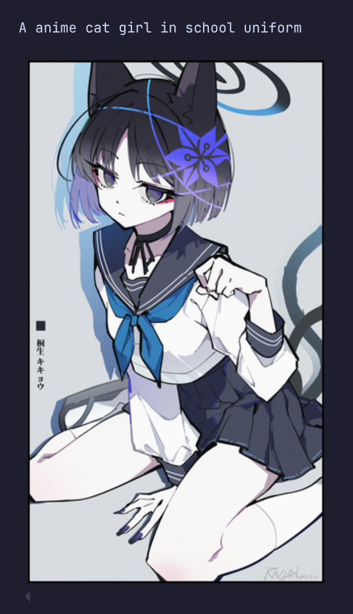 | 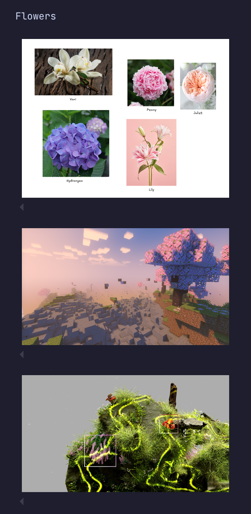 | 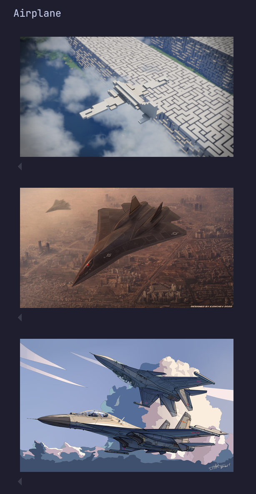 |
| ---------------------------------- | ------------------------------- | -------------------------------- |
<p align="center"><i>Example semantic-search results for several text queries</i></p>

Images are embedded with a Perception Encoder model (loaded through LibreYOLO) and stored in a ChromaDB collection using cosine distance. A text query is embedded with the same model, and return results above a similarity threshold.

<p align="center">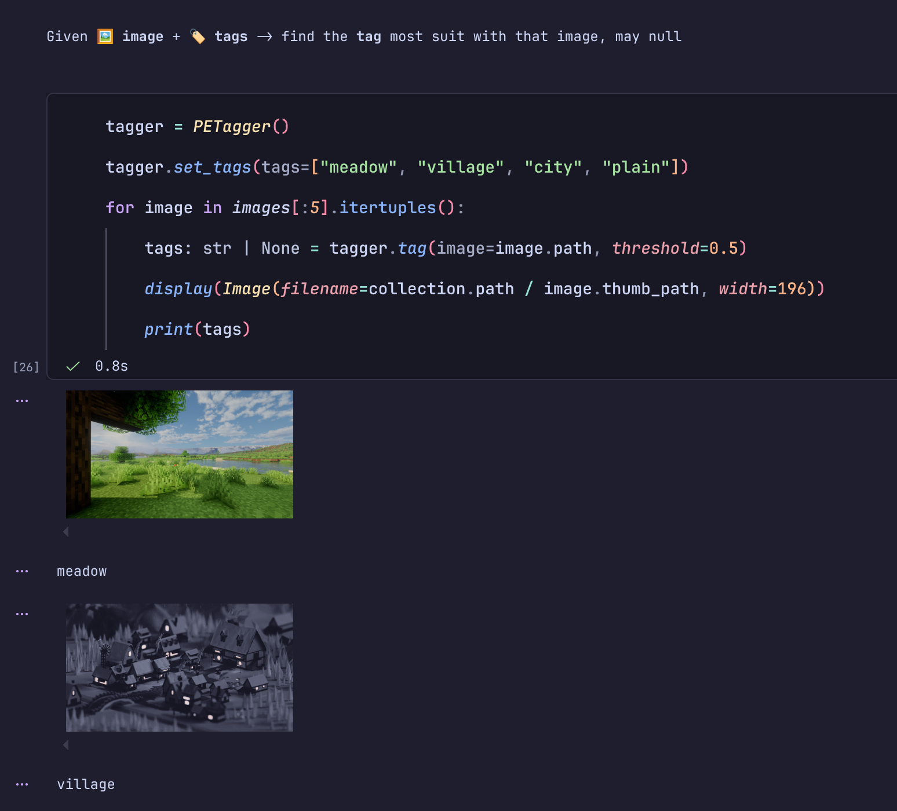</p>
<p align="center"><i>Assign most suit tag for images</i></p>

Some tagging strategies:

| Approach                      | Type                              | Output                                       | Notes                               |
| ----------------------------- | --------------------------------- | -------------------------------------------- | ----------------------------------- |
| YOLO classifier               | Closed-set (ImageNet1000 classes) | Top-5 classes, filtered above 0.5 confidence | Simple, but limited vocabulary      |
| Perception Encoder & SigLIP 2 | Open-set, multi-label             | Tags above 0.65                              | Flexible, but compute heavy (embed) |

### 4.6 Filtering and EDA

Filtering is expressed as an `ImageFilter` (a `TypedDict` whose conditions combined with AND): name, format, size, dimensions, orientation, rating, tags (any/all/has), timestamps, and color proximity.

The EDA module adds derived features (megapixels, aspect ratio snapped to common ratios, resolution tier, hour and weekday of creation, source folder) and a set of analyses:

- Data audit (null rates, ranges, suspicious timestamps)
- Format share of files, format share of disk
- Tag co-occurrence
- Near-duplicate detection by embedding cosine similarity
- Rating prediction: ridge regression from embeddings to rating
- ... and some fun!

<p align="center">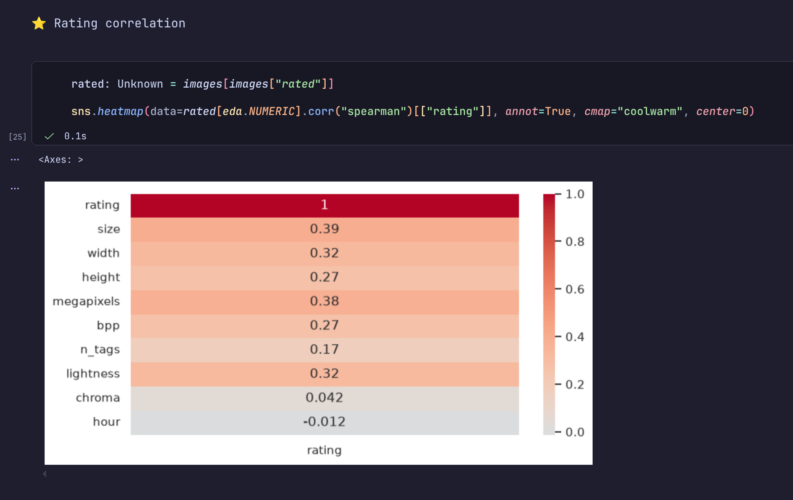</p>
<p align="center"><i>Rating correlation</i></p>

<p align="center">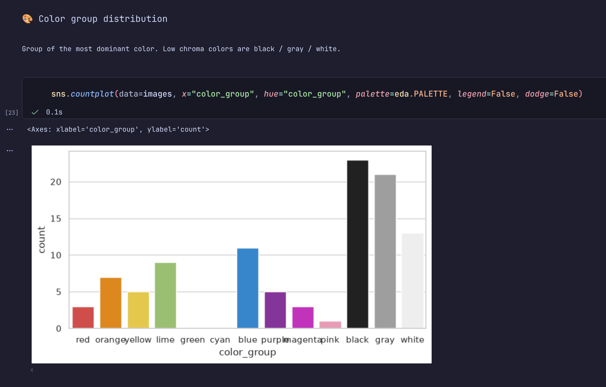</p>
<p align="center"><i>Color distribution</i></p>

<p align="center">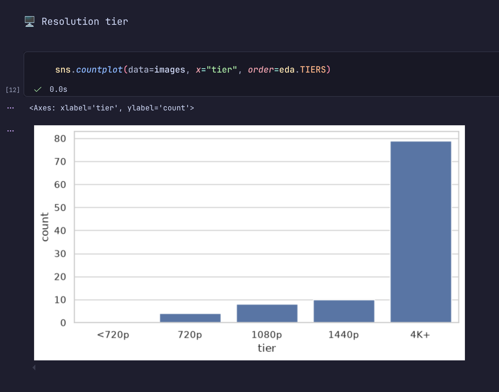</p>
<p align="center"><i>Resolution</i></p>

<p align="center">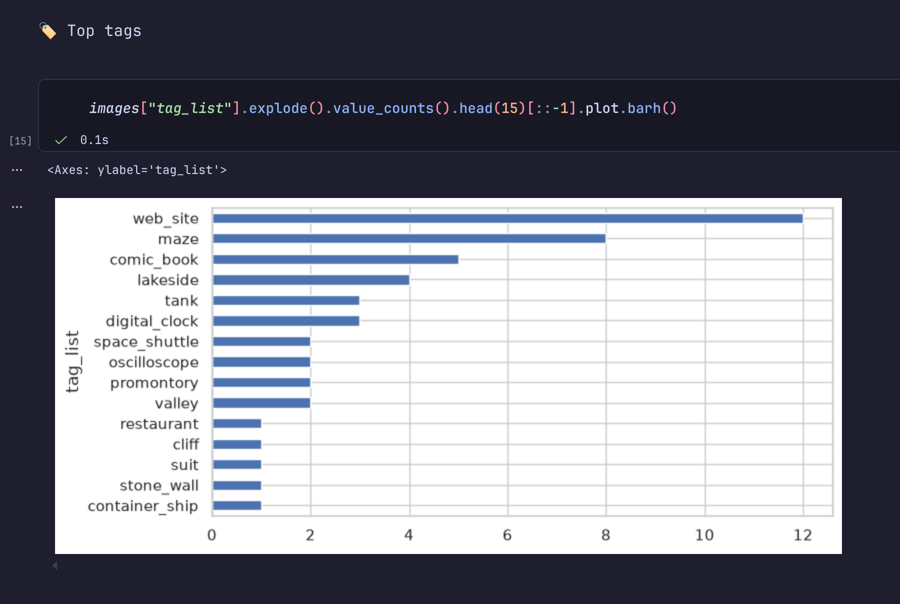</p>
<p align="center"><i>Top tags</i></p>

### 4.7 Desktop GUI

<p align="center">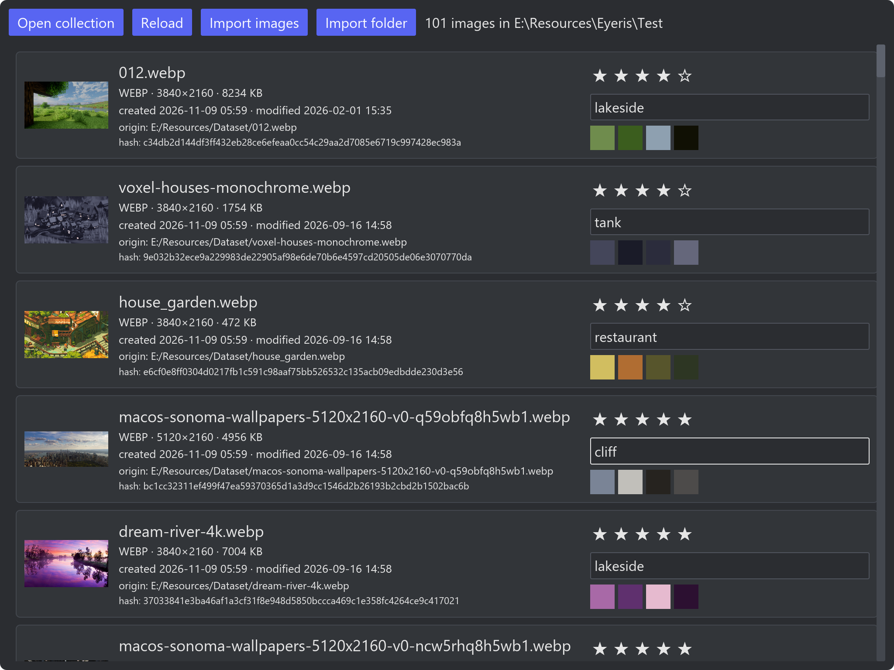</p>
<p align="center"><i>Made in Rust using Iced</i></p>

The GUI is built with `iced`. It lists images with thumbnails, metadata, swatches of dominant colors, a five-star rating control, and a comma-separated tag editor. It can open a collection and import images or whole folders. Edits are saved to the database on interaction.

&nbsp;

## 5. Evaluation and Results

Eyeris was built as an exploratory prototype, so evaluation is mostly qualitative.

### 5.1 Search and Tagging Quality

Qualitatively, free-text queries ("a picture of forest", "thunder storm") return plausible top results at low thresholds, while abstract or stylistic queries are less reliable.

Closed-set YOLO tags are precise on common objects but miss anything outside their vocabulary.

SigLIP 2 and Perception Encoder tagging are more flexible but sensitive to thresholds and to how candidate tags are phrased.

No formal precision/recall study was done.

### 5.2 Collection Insights

The EDA notebook is the most useful part of the project. For example:
- finding a share of storage taken by a few large PNGs
- finding clusters of bulk-copied timestamps
- finding near-duplicate pairs or semantically similar pairs

&nbsp;

## 6. Limitations and Lessons Learned

### 6.1 Known Limitations

- **XMP write-back is unstable.** The `xmp` crate can read and write a custom `eyeris` namespace (`Rating`, `Tags`) via `xmp_toolkit`, but writing proved unreliable across files and formats. Ratings and tags currently live only in `index.db`. This undermines the original portability goal.
- **Implicit, duplicated schema.** The table is created in Rust, queried in Python, and re-queried in the GUI with hand-written SQL.
- **Fragile consistency.** Embeddings are keyed by database row id, and thumbnails are generated after the DB insert; a failure in between leaves the stores out of sync.
- **String-encoded tags.** The pipe-separated format blocks characters and complicates queries.
- **Subprocess coupling.** Python depends on a hard-coded path to `target/release/cli`.
- **Limited formats.** Only JPEG, PNG and WEBP, although can accepts more extensions.

### 6.2 Architectural Weaknesses

The root problem was not either language but the seam between them. There was no single source of truth: no shared schema, no shared domain model, and no API boundary, only a file and a binary.

Each new feature (tags, filters, GUI edits) touched the database from a different place, so the same knowledge was re-implemented several times. We concluded that patching this would cost more than redesigning it.

### 6.3 What Worked Well

- Content-addressed folders made deduplication nearly free.
- Strict lints in Rust caught many edge cases early.
- Notebooks made it cheap to try models and analyses.

### 6.4 Lessons Learned

1. Don't use Rust with Python (or Python with Rust) in this way! (subprocess, no contract)
2. Remember lesson 1.

&nbsp;

## 7. Project Status and Future Work

### 7.1 Archived

The repository was archived on November 11, 2026.

The current architecture is so poorly designed to be growth. And continuing to build on it would make our brain explode.

We planned to move the development to a new repository with a cleaner design.

### 7.2 Plan

The successor would entirely written in Rust and will have:

- A reliable metadata strategy, with XMP either fixed or replaced by a well-tested sidecar approach.
- Semantic search and tagging integrated seamlessly into the workflow.
- A normalized tag model.
- A polish UI!

New repository: \*not started yet ლ(・﹏・ლ)\*

&nbsp;

## 8. Conclusion

Eyeris showed that a local-first collection, pixel-hash deduplication, and embedding-based search can be combined into a useful DAM prototype with modest code. 

It also showed how quickly an unstructured hybrid architecture become broken. The most valuable outcome is the set of design lessons that will shape the successor project.

&nbsp;

## Acknowledgments

Thanks to the maintainers of [LibreYOLO](https://github.com/LibreYOLO/libreyolo), Perception Encoder, SigLIP 2, ChromaDB, `iced`, `xmp_toolkit`, `rayon`, `rusqlite`, and `okmain`, and to Professor Nguyễn Thị Hoàng Yến.

&nbsp;

## References

1. digiKam. https://digikam.org/
2. Eagle. https://eagle.cool/
3. BLAKE3. https://github.com/BLAKE3-team/BLAKE3
4. Björn Ottosson. [A perceptual color space for image processing](https://bottosson.github.io/posts/oklab/) (OKLab).
5. SigLIP 2. [SigLIP 2: A better multilingual vision language encoder](https://huggingface.co/blog/siglip2)
6. Perception Encoder. [Perception Encoder: The best visual embeddings are not at the output of the network](https://ai.meta.com/research/publications/perception-encoder-the-best-visual-embeddings-are-not-at-the-output-of-the-network/)

&nbsp;

## Devlogs

### \#1 Rust + Python is just a joke

From the day we present the project idea, we decided to code fully in Python. Because it would be very easy to run ML models and perform data analysis.

One of our friend said, making app with Python will result in terrible performance. Yeah, some true. We said if we have time, we will make a Rust version of it. With ONNX runtime to run ML models, robust data analysis with DuckDB, performance UI with GPUI.

For 2nd university students, it's easy for them to think they can do all the job of an entire department in half a year in a month.

We are. So we chase them all!

Till the day... "Omg! There is only 2 weeks left! We have a broken Rust indexing system, some python script to test some ML models, fragile data analysis functions here and there, a non-sense GUI made using Slint with callback linking broken there and here!"

Less is more. More is less.

We want to do too many things.

The initial design of the UI:

<p align="center">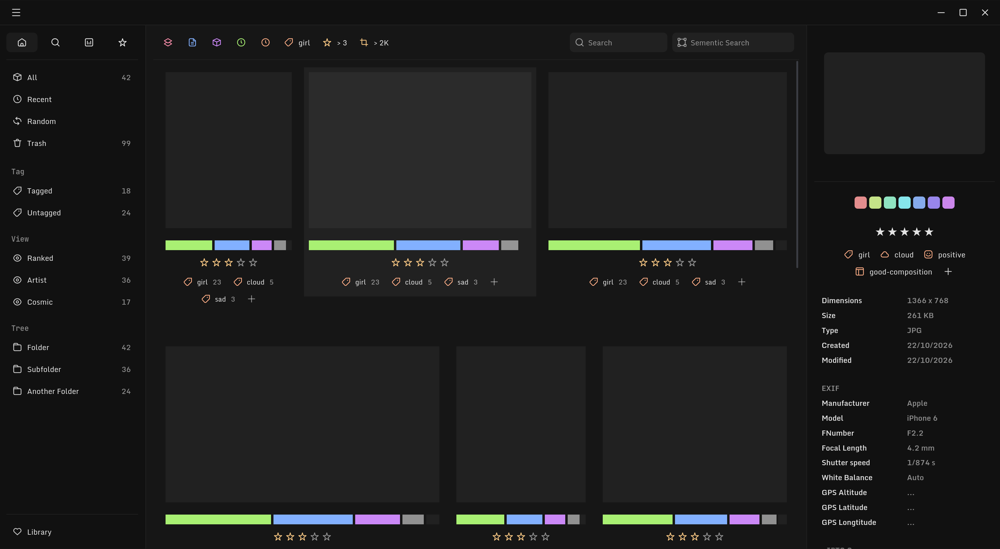</p>
<p align="center"><i>Initial Design</i></p>

Half cooked using Slint [v0.0.1-preview.2](https://github.com/FwLKhW/Eyeris/releases/tag/v0.0.1-preview.2):

<p align="center">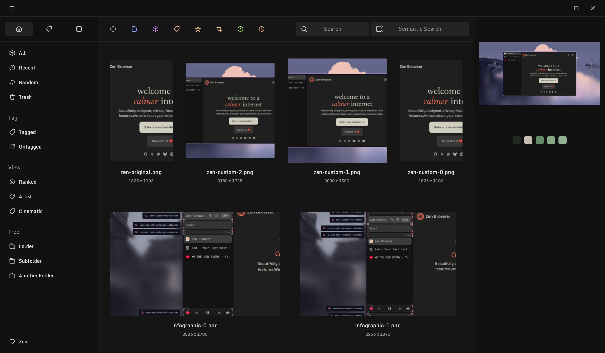</p>
<p align="center"><i>Half cooked using Slint</i></p>

And an performance but broken indexing system: [FwLKhW/image-indexing-engine](https://github.com/FwLKhW/image-indexing-engine)

Do all that just to end up in trauma when the time is up. Make many but nothing is made.

What could we do?

The GUI made with Slint seem good, but far from expectation, mostly because the complexity when working with DSL for the fist time. Further more, we already have a fast indexing pipeline in Rust, we just cannot suffer from write a slower one?!.

Not to say, Rust will not help us complete even a prototype, not mention a final stable app. Cannot imagine how in the world we can implement ML + data analysis + GUI in Rust in 2 weeks.

With all we have. We choose the worst but the only possible decision: Rust + Python.

(╥﹏╥)
